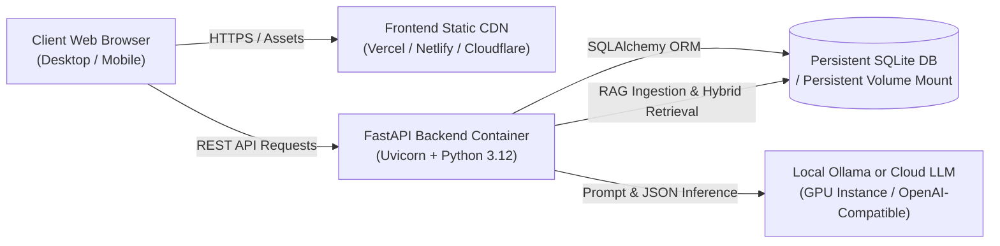

# RoadmapIQ Production & Deployment Guide

This document outlines the deployment architecture, infrastructure requirements, and operational strategies for hosting **RoadmapIQ** in production.

---

## 1. System Architecture Overview



RoadmapIQ is decoupled into three primary architectural tiers:
1. **Frontend**: Static Single-Page Application (SPA) built with React 18, Vite, and Tailwind CSS.
2. **Backend**: Asynchronous REST API service built with FastAPI, Pydantic v2, and the deterministic rule & DAG sequencing engines.
3. **Data & AI Tier**: Persistent SQLite database storing curriculum requirements, student profiles, and progress snapshots; and an Ollama inference service providing local LLM intelligence with deterministic semantic fallbacks.

---

## 2. Frontend Deployment

### Build Command & Output
- **Build Command**: `cd frontend && npm run build`
- **Output Directory**: `frontend/dist/`
- **Configuration**: `frontend/vite.config.js`

### Recommended Hosting Providers
- **Vercel / Netlify**:
  - Connect your Git repository.
  - Set Root Directory: `frontend`
  - Build Command: `npm run build`
  - Output Directory: `dist`
  - Single-Page Application rewrite rule: All paths `/*` route to `/index.html`.
- **AWS S3 + CloudFront**:
  - Upload `dist/` contents to an S3 bucket with static website hosting.
  - Configure a CloudFront CDN distribution with custom 404 error page pointing to `/index.html` (HTTP 200) for client-side routing.

### Frontend Environment Variables
| Variable | Default Value | Description |
|---|---|---|
| `VITE_API_BASE_URL` | `http://localhost:8000/api` | The public base URL of the FastAPI backend. Never put secrets or API keys in frontend variables. |

---

## 3. Backend Deployment

### Containerization (Dockerfile)
To containerize the FastAPI service, create a `backend/Dockerfile`:

```dockerfile
FROM python:3.12-slim

WORKDIR /app

# Install system dependencies
RUN apt-get update && apt-get install -y --no-install-recommends \
    build-essential \
    && rm -rf /var/lib/apt/lists/*

# Install Python requirements
COPY requirements.txt .
RUN pip install --no-cache-dir -r requirements.txt

# Copy application code
COPY . .

# Expose port
EXPOSE 8000

# Set environment
ENV PYTHONPATH=/app

# Run uvicorn server
CMD ["uvicorn", "app.main:app", "--host", "0.0.0.0", "--port", "8000"]
```

### Recommended Backend Hosting Providers
- **Render / Railway / Fly.io**:
  - Deploy the Docker container directly.
  - Attach a **Persistent Disk** (e.g. at `/data`) so that `roadmapiq.db` is not erased across container restarts.
  - Set `DATABASE_URL=sqlite:////data/roadmapiq.db`.
- **AWS ECS / DigitalOcean App Platform**:
  - Deploy as a containerized service with an attached volume for database persistence.

### Backend Environment Variables
| Variable | Default Value | Description |
|---|---|---|
| `DATABASE_URL` | `sqlite:///./roadmapiq.db` | SQLAlchemy connection URI. Supports SQLite locally and on persistent disks. |
| `CORS_ORIGINS` | `["http://localhost:5173", ...]` | JSON list of allowed origins. In production, set to your production frontend domain (e.g. `["https://roadmapiq.yourdomain.com"]`). |
| `OLLAMA_BASE_URL` | `http://localhost:11434` | Base URL of the Ollama server. |
| `OLLAMA_MODEL` | `llama3` | Configured model identifier. |
| `OLLAMA_TIMEOUT_SECONDS` | `5.0` | Maximum seconds before graceful fallback to deterministic engine. |
| `DEFAULT_AI_ENABLED` | `true` | Toggle for AI mentorship features. |

---

## 4. Serving LLMs in Production: Local vs. Cloud

> [!IMPORTANT]
> A local Ollama process running on a laptop (`http://localhost:11434`) **cannot serve a public production website**, because public cloud servers cannot reach a personal machine without complex, fragile tunnels.

### Production AI Infrastructure Options:

1. **Dedicated GPU Cloud Instance with Ollama or vLLM**:
   - Host Ollama or vLLM on a cloud GPU instance (e.g. AWS EC2 `g5.xlarge`, RunPod, Lambda Labs, or Hetzner).
   - Pull the model: `ollama pull llama3`.
   - Point your FastAPI container to the private internal IP: `OLLAMA_BASE_URL=http://<gpu-internal-ip>:11434`.

2. **Self-Hosted Open-Weights Endpoint / Serverless API**:
   - Use an OpenAI-compatible open-weights provider (e.g. Together AI, Groq, OpenRouter) running open-source models like Llama 3 or Mistral.
   - Point the backend client to the endpoint URL.

3. **Air-Gapped & Offline Fallback (Built-in)**:
   - If the AI server is temporarily unreachable, RoadmapIQ's `ai_service.py` **automatically falls back** to its built-in Curriculum Intelligence engine with zero downtime. All deterministic calculations, gap analysis, topological sequencing, and RAG retrieval continue working normally.

---

## 5. Security & Production Hardening Checklist

1. **CORS Restrictions**:
   - Restrict `CORS_ORIGINS` in production to only your official frontend domain. Never leave `*` wildcard in public deployments.
2. **Database Backup**:
   - For SQLite, schedule periodic automated snapshots using SQLite's online backup API or a cron job copying `/data/roadmapiq.db` to Amazon S3.
3. **Graceful Degraded Mode**:
   - Verify that all endpoints return HTTP 200/201 even when external AI models are offline, utilizing deterministic rule engines.
4. **Rate Limiting**:
   - Place a reverse proxy (Nginx or Cloudflare) in front of the backend to rate-limit `/api/ai/*` queries and prevent resource exhaustion.

