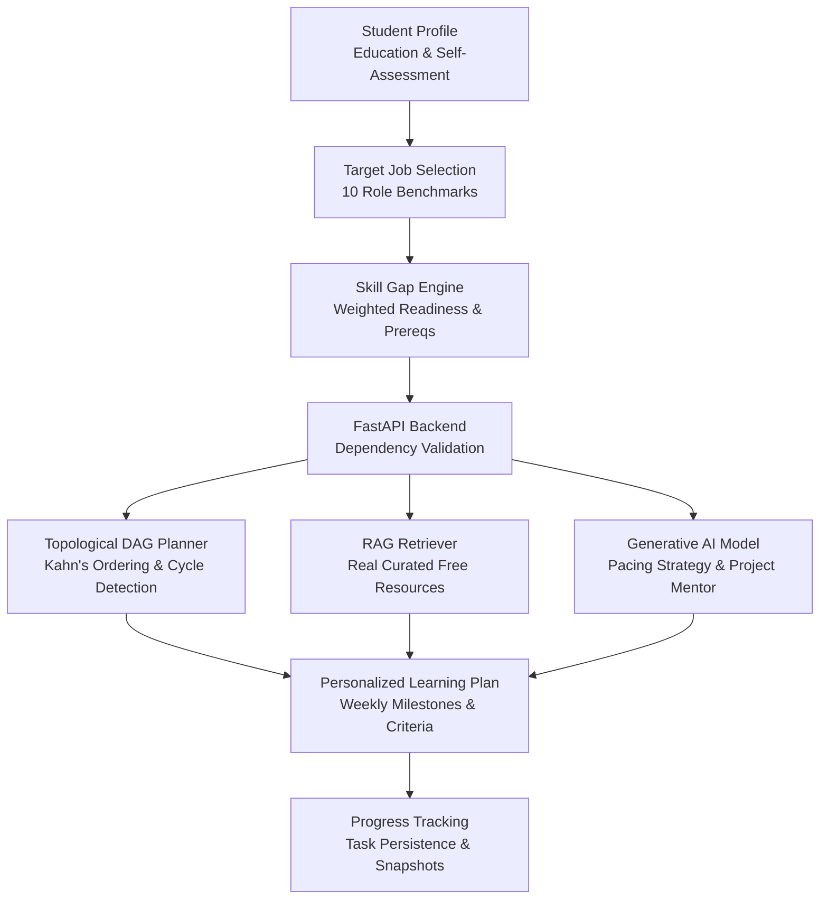

# RoadmapIQ System Architecture & Integration Guide

Brand Tagline: **"Your Skills. Your Path. Your Future."**

## 1. Overview
RoadmapIQ is an intelligent career roadmap and placement preparation platform. It computes mathematical readiness baselines, sequences skills using Directed Acyclic Graph (DAG) topological sorting, retrieves grounded study materials via a verified RAG pipeline, and provides local Generative AI mentorship.

---

## 2. Technology Stack

### Frontend
- **Framework**: React 18 + Vite
- **Routing**: React Router DOM v6
- **Styling**: Tailwind CSS with custom dark navy palette (`#060a12`, `#0a0f1d`, `#0e1628`), electric cyan accents (`#00f0ff`, `#38bdf8`), and glassmorphism.
- **Icons**: Lucide React
- **Data Visualization**: Recharts (Radar charts for skill gaps, Bar charts for weekly effort distribution)
- **HTTP Client**: Axios with centralized error interceptor and timeout configuration
- **Environment**: Configured via `VITE_API_BASE_URL=http://localhost:8000/api`

### Backend
- **Framework**: Python 3.12 + FastAPI
- **Database**: SQLite (with SQLAlchemy ORM, foreign keys enabled, and auto-seeding)
- **Validation**: Pydantic v2 schemas
- **Planning Engine**: Kahn's algorithm with priority tie-breaking by importance weight
- **RAG Engine**: Token-overlap & semantic relevance retriever querying real `LearningResource` records
- **AI Service**: Local Ollama LLM (`http://localhost:11434`, model `llama3`) with deterministic fallback synthesis

---

## 3. End-to-End Workflow & 11 Application Pages

| # | Route | Page | Purpose |
|---|-------|------|---------|
| 1 | `/` | **Landing Page** | Brand mission, hero value propositions, architecture workflow, and role teasers. |
| 2 | `/profile` | **Student Profile** | Student identity, education level, weekly study hours (3-60), target duration (2-52 weeks), learning format, and self-reported skills proficiency (1-3). |
| 3 | `/careers` | **Career Explorer** | 10 standardized technical roles with descriptions, salary benchmarks, required core skills, and recommended projects. |
| 4 | `/dashboard` | **Main Dashboard** | Executive summary, overall readiness gauge, active streak, weekly progress chart, and immediate pending tasks. |
| 5 | `/skill-gap` | **Skill Gap Analysis** | Readiness percentage, categorized breakdown (Met, Needs Improvement, Missing, Blocked), radar chart comparison, and "AI Explain" modal. |
| 6 | `/roadmap` | **AI-Generated Roadmap** | Weekly accordion sections with expandable task cards, estimated hours, priority badges, completion criteria, free vetted resources, task completion checkboxes, and AI study advice. |
| 7 | `/assistant` | **RAG Learning Assistant** | Interactive AI chat grounded strictly in verified database resources with clickable external URLs. Clear negative match handling without hallucinating citations. |
| 8 | `/resources` | **Free Resource Library** | Searchable and filterable free resources (by skill, difficulty, format). Ratings, provider badges, bookmarks, and external links. |
| 9 | `/projects` | **Project Recommendations** | Real capstone and portfolio projects matched to role and skill gaps, showing problem statement, suggested tech stack, milestones, and "AI Project Mentor" modal with starter code. |
| 10 | `/interview` | **Interview Preparation** | Placement question bank across DSA, Core CS, Technical, and HR/Behavioral. Expandable sample answers, key points, completion toggle, and AI Mock Practice evaluation with score 1-10. |
| 11 | `/settings` | **Settings & Diagnostics** | FastAPI health check, Ollama AI provider status, pacing adjustment sliders, and local cache reset. |

---

## 4. API Endpoints Reference

### Health & System
- `GET /api/health` – Backend health check.
- `GET /api/ai/status` – Ollama local AI status and model diagnostic.

### Career Roles & Skills
- `GET /api/roles` – List 10 active career roles.
- `GET /api/roles/{id_or_slug}` – Detailed role curriculum, requirements, projects, and interview topics.
- `GET /api/skills` – List all skills with prerequisite edges.
- `GET /api/skills/prerequisites` – Full prerequisite graph mapping.

### Student Profile
- `POST /api/profile` – Create new student profile.
- `GET /api/profile/latest` – Retrieve most recent student profile.
- `GET /api/profile/{id}` – Retrieve student profile by ID.
- `PUT /api/profile/{id}` – Update student profile.

### Roadmap & Task Management
- `POST /api/roadmaps/generate` – Execute rule engine, prerequisite DAG sort, and generate persistent weekly plan.
- `GET /api/roadmaps/{id}` – Retrieve roadmap with tasks and resources.
- `GET /api/roadmaps/{id}/progress` – Retrieve progress statistics and weekly effort distribution.
- `GET /api/roadmaps/{id}/skill-gaps` – Retrieve skill-gap analysis for roadmap.
- `POST /api/skill-gaps/analyze` – Ad-hoc skill gap analysis for a role and skill set.
- `PATCH /api/tasks/{task_id}` – Toggle task completion status and update progress snapshot.

### Resources & Projects
- `GET /api/resources` – Filter free learning resources by skill, difficulty, format, search query.
- `POST /api/resources/{id}/bookmark` – Toggle resource bookmark for student.
- `GET /api/projects` – Retrieve portfolio projects filtered by role or difficulty.

### Interview Preparation & AI Mentorship
- `GET /api/interview/questions` – Retrieve interview questions by category and role.
- `PATCH /api/interview/questions/{id}` – Toggle completed or bookmarked status.
- `POST /api/interview/feedback` – Submit student answer for AI rubric evaluation and follow-up probes.
- `POST /api/ai/roadmap-advice` – Generate personalized study pacing and bottleneck advice.
- `POST /api/ai/skill-gap-explanation` – Deep dive into why a skill matters for a role.
- `POST /api/ai/learning-assistant` – RAG query endpoint with grounded curriculum sources.
- `POST /api/ai/project-mentor` – Milestone architecture breakdown, starter code snippet, and testing strategy.

---

## 5. Security & Configuration
- **No Client Secrets**: AI credentials and provider URLs remain exclusively on the FastAPI backend.
- **CORS Configuration**: Configured in FastAPI for `http://localhost:5173`, `http://127.0.0.1:5173`, and standard development origins.
- **Relational Persistence**: Browser localStorage stores only non-sensitive cache identifiers (`roadmapiq_profile_id`, `roadmapiq_roadmap_id`). All state is authoritatively held in SQLite.

